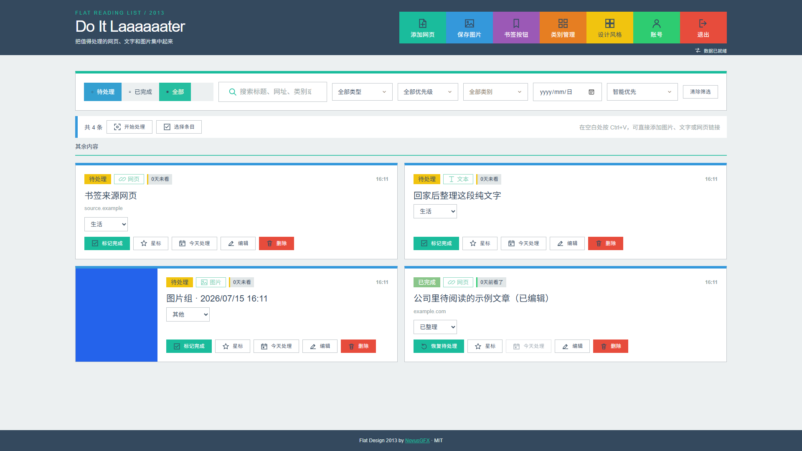
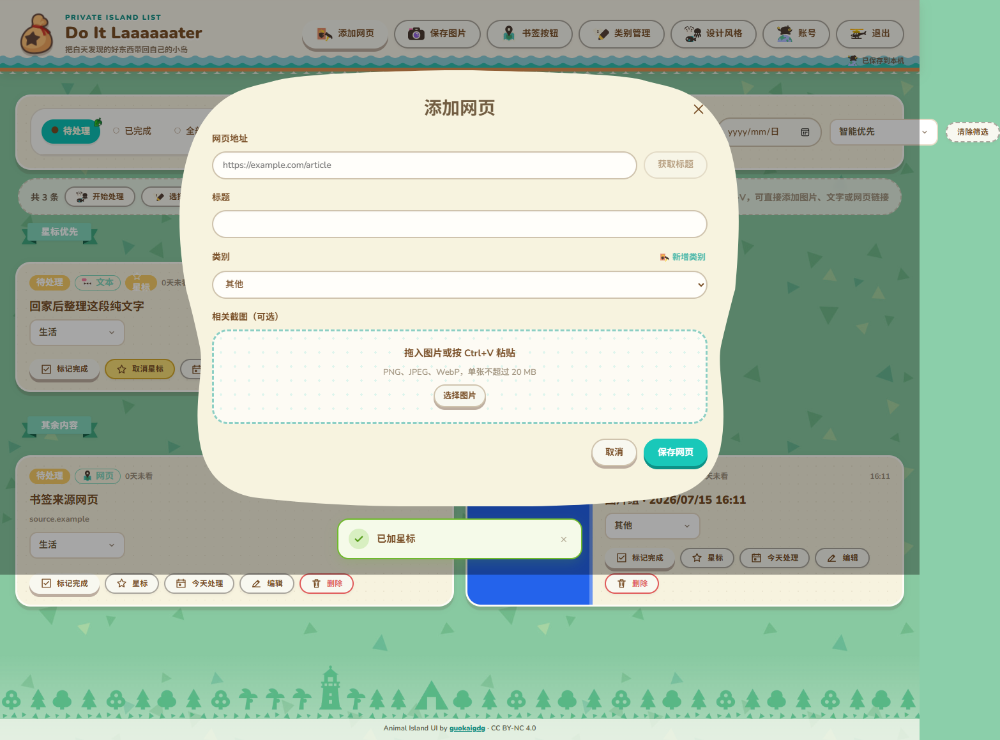

# Do It Laaaaaater

<div align="center">
  
  <p><strong>把白天发现的网页、文字和图片集中起来，晚上再认真处理。</strong></p>
  <p>单用户 · 自托管 · Cloudflare Workers + D1 + R2 · 稍后阅读 · 图片收藏 · 无限备忘录画布 · PWA</p>
</div>

Do It Laaaaaater 是一个为个人使用设计的稍后阅读与灵感收集系统。它可以保存网页、纯文本、截图和图片组，也提供星标、计划日期、晚间处理、离线缓存、ZIP 备份恢复和一张持续保存的无限备忘录画布。

应用采用统一的 **Cloudflare Workers + D1 + R2** 云端 Web / PWA 架构：一份部署同时适配电脑浏览器与手机（含 iPhone 主屏幕 PWA），跨设备实时同步。旧版的 Windows 本机独立模式与 Vercel + Supabase 架构已移除。

> [!IMPORTANT]
> 这是单用户应用。每个实例只能创建一个账号，第一个成功注册的人会成为唯一所有者。完成首次建号前不要把网址公开给其他人。

| Flat Design 2013（默认） | Animal Island UI |
| --- | --- |
|  |  |

## 功能概览

- 保存网页、文字、PNG、JPEG 和 WebP 图片。
- 直接粘贴网址、文字或多张图片，不必先打开添加窗口。
- 自动读取网页标题和封面，失败时可以手动填写。
- 网址去重、类别、搜索、日期分组、状态、星标和计划日期。
- 智能优先、晚间处理模式、卡片快捷操作与批量处理。
- 7 天回收站、撤销、恢复和彻底删除。
- 一张全账号共享的无限备忘录画布，支持文字、图片、画笔、橡皮擦、缩放、旋转和多种背景。
- 画布中的资料卡与首页使用同一份数据，编辑、完成或删除会同步生效。
- ZIP 备份与恢复，可选择是否包含全部原图（支持从旧版 Vercel 站点无缝迁移）。
- 桌面与移动端统一 PWA、iPhone 添加到主屏幕、剪贴板快捷指令和浏览器书签按钮。
- Flat Design 2013 与 Animal Island UI 两套可切换界面。

更完整的功能说明见下方的[使用与数据说明](#使用与数据说明)。

## 架构概览

| 组件 | 作用 |
| --- | --- |
| **Cloudflare Workers** | 托管前端静态页面（Workers Static Assets）与 `/api/*` 后端接口、网页元信息抓取 |
| **Cloudflare D1** | SQLite 数据库，保存唯一账号、登录会话、分类、条目、偏好与备忘录画布 |
| **Cloudflare R2** | 私有对象存储，保存条目原图、WebP 缩略图与画布图片（不公开暴露） |
| **Web / PWA** | 电脑与手机统一响应式界面，支持安装到桌面 / 主屏幕与离线队列同步 |

## 交给 AI / Codex 协助部署

如果你不熟悉 Cloudflare、D1 或 R2，可以把下面整段内容复制给你的编程助手。它会帮你准备命令并逐步引导操作：

```text
请协助我部署 Do It Laaaaaater：
https://github.com/Andrei12138/do-it-laaaaaater

目标：部署一个只属于我的个人实例，使用 Cloudflare Workers + D1 + R2，并保留以后从 GitHub 更新的能力。

请按以下规则协助：
1. 先阅读仓库中的 README.md、DEPLOYMENT.md、wrangler.jsonc、migrations/0001_init.sql 和 .env.example。
2. 帮我把项目 Fork 到自己的 GitHub 账号，并克隆到我指定的本机目录；不要直接修改上游仓库。
3. 检查 Node.js 是否为 22.13 至 24.x，安装依赖并确认项目可以构建。
4. 引导我运行 npx wrangler login 登录 Cloudflare，并在控制台开通 R2。
5. 引导我创建 D1 数据库 do-it-laaaaaater-db，并将返回的 database_id 填入 wrangler.jsonc；再创建私有 R2 存储桶 do-it-laaaaaater-images（不要开启公开访问）。
6. 引导我运行 npm run db:migrate:remote 初始化数据库，再运行 npm run deploy 完成部署。
7. 如需国内稳定访问，引导我在 Cloudflare 控制台为 Worker 绑定自定义域名。
8. 不要让我发送任何 Cloudflare API Token、账号密码或私钥。
9. 部署后帮助我检查首次建号、登录、保存文字/图片、备忘录画布和手机 PWA 安装；如果我有旧版 Vercel 站点数据，指导我先导出含原图 ZIP 再导入新站。
10. 每次只告诉我当前需要完成的一个步骤，等我回复“完成”或贴出输出后再继续。
```

## 快速部署到 Cloudflare

需要准备：一个 **Cloudflare 账号**（并开通 R2）、本机 **Node.js `22.13` 至 `24.x`**，约 5～10 分钟。

```bash
# 1. 克隆仓库并安装依赖
git clone https://github.com/Andrei12138/do-it-laaaaaater.git
cd do-it-laaaaaater
npm install

# 2. 登录 Cloudflare
npx wrangler login

# 3. 创建 D1 数据库，并把输出的 database_id 填入 wrangler.jsonc
npx wrangler d1 create do-it-laaaaaater-db

# 4. 创建 R2 私有图片存储桶（不要开启公开访问）
npx wrangler r2 bucket create do-it-laaaaaater-images

# 5. 初始化远端数据库表结构
npm run db:migrate:remote

# 6. 构建并发布到 Cloudflare Workers
npm run deploy
```

部署完成后：

1. （推荐）在 Cloudflare 控制台 → **Workers & Pages → `do-it-laaaaaater` → Settings → Domains & Routes** 绑定你的自定义域名。
2. 打开网址并立即创建唯一账号（密码至少 10 个字符）。建号成功后注册入口会自动关闭。
3. 如需让书签按钮与 iPhone 快捷指令固定指向自定义域名，可在构建前复制 [`.env.example`](.env.example) 为 `.env.local` 并填写 `VITE_PUBLIC_APP_URL`。

完整图文式步骤、自定义域名配置、日常升级与常见问题见 [DEPLOYMENT.md](DEPLOYMENT.md)。

## 从旧版 Vercel 站点迁移

如果你之前部署过旧版 **Vercel + Supabase** 实例，只需 3 步即可把全部数据（含原图与画布）搬到新的 Cloudflare 实例：

1. **在旧版 Vercel 站点导出备份**：登录后进入 **账号 → 数据备份与恢复**，勾选 **包含全部原图**，导出完整 `.zip` 备份文件。
2. **部署新站并建号**：按上方步骤部署新的 Cloudflare 实例，打开新网址注册你的唯一账号。
3. **在新站导入备份**：进入 **账号 → 数据备份与恢复**，上传刚才导出的 `.zip` 文件，选择 **完整覆盖**（新实例为空时推荐）即可完整还原。

详细迁移检查清单见 [DEPLOYMENT.md#从旧版-vercel-站点迁移数据](DEPLOYMENT.md#从旧版-vercel-站点迁移数据)。

## 使用与数据说明

### 收集与处理

- 首页可以直接粘贴网址、文字和多张图片。
- 网页标题与封面会自动获取，失败不会阻止保存。
- 重复网址不会覆盖原条目或重置录入时间。
- “智能优先”依次显示逾期、今天、星标和其余内容；其余内容按中国时间的录入日期分组。
- 待处理条目显示“X 天未看”，已完成条目显示“X 天前看了”。
- 选择模式支持整张卡片点选和批量状态、类别、星标、计划及回收站操作。

### 图片与画布

- 单张图片不超过 20 MB，每组最多 30 张；上传时浏览器自动生成 WebP 缩略图以加快列表加载。
- 普通删除只移入 7 天回收站，彻底删除后才清理 R2 中的关联图片。
- 每个账号只有一张持续保存的无限画布，画布卡片直接引用资料库原条目。
- 备份格式可包含条目原图、画布内容和画布原图。

### 离线与 PWA

- PWA 缓存网页外壳与版本化静态资源，支持电脑端安装应用与 iPhone Safari“分享 → 添加到主屏幕”。
- 登录后的清单、文本和已同步图片保存在按账号隔离的浏览器 IndexedDB 中。
- 离线修改会进入本机队列，恢复网络后按顺序自动同步。
- 应用不会保存外部网页的完整正文；断网时可整理清单与查看已缓存图片，打开原网页仍需网络。

## 项目结构

```text
src/                    前端页面、主题、离线存储队列、备份恢复与交互
worker/                 Cloudflare Worker 后端接口、鉴权、图片读写与网页抓取
migrations/             Cloudflare D1 数据库建表与迁移脚本
public/                 PWA 清单、Service Worker、应用图标和画布离线字体
tests/                  单元测试与自动检查
docs/                   README 截图
licenses/               第三方许可文本
wrangler.jsonc          Cloudflare Workers、D1 与 R2 绑定配置
```

## 本机开发与检查

```bash
npm run db:migrate:local  # 初始化本机 Wrangler 模拟 D1 数据库
npm run dev               # 启动 Wrangler 本地 Worker + 静态资源预览（127.0.0.1:8787）
npm run dev:web           # 启动 Vite 前端热更新（127.0.0.1:5173，自动代理 /api）
npm run typecheck         # 检查前端与 Worker 类型
npm test                  # 运行自动化测试
npm run build             # 类型检查并构建正式前端产物
npm run check             # 类型检查 + 自动化测试 + 正式构建
npm run deploy            # 构建并部署到 Cloudflare Workers
```

主要技术：React、TypeScript、Vite、Cloudflare Workers、Cloudflare D1、Cloudflare R2、Excalidraw、Vitest。

## 安全边界

- 单用户锁定：首个账号注册后自动关闭注册接口；密码使用 PBKDF2-SHA256 加盐存储，会话采用 `HttpOnly` Cookie。
- 私有存储：R2 图片桶不对外公开，所有图片读写均经 Worker 验证当前会话与归属权。
- 网页元信息抓取内置超时、响应体积限制与内网/危险地址拦截（SSRF 防护）。
- ZIP 恢复会校验格式版本、文件类型、单图大小、组内数量、路径安全与清单一致性。
- `.env`、`.env.local`、`.wrangler/`、构建产物和测试结果均已加入 `.gitignore`。

## 主题、素材与使用范围

- **Flat Design 2013**：基于 NovusGFX Retro Design System，MIT。
- **Animal Island UI**：组件与素材版本 `1.2.2`，CC BY-NC 4.0。
- **Excalidraw**：无限画布基础，MIT；相关离线字体保留各自许可。

由于 Animal Island UI 素材采用 **CC BY-NC 4.0**，包含这些素材的默认版本仅适合个人、非商业部署。请保留页面底部和仓库中的作者署名。商业使用前需要替换相关素材或另行取得授权。

本项目自身代码目前没有单独声明通用开源许可证。仓库公开主要用于展示、学习和个人非商业自部署；再分发、商用或将代码合入其他产品前，请先联系项目所有者并核对所有第三方许可。

完整来源、固定版本和许可文本见 [THIRD_PARTY_NOTICES.md](THIRD_PARTY_NOTICES.md) 与 [`licenses/`](licenses/)。
